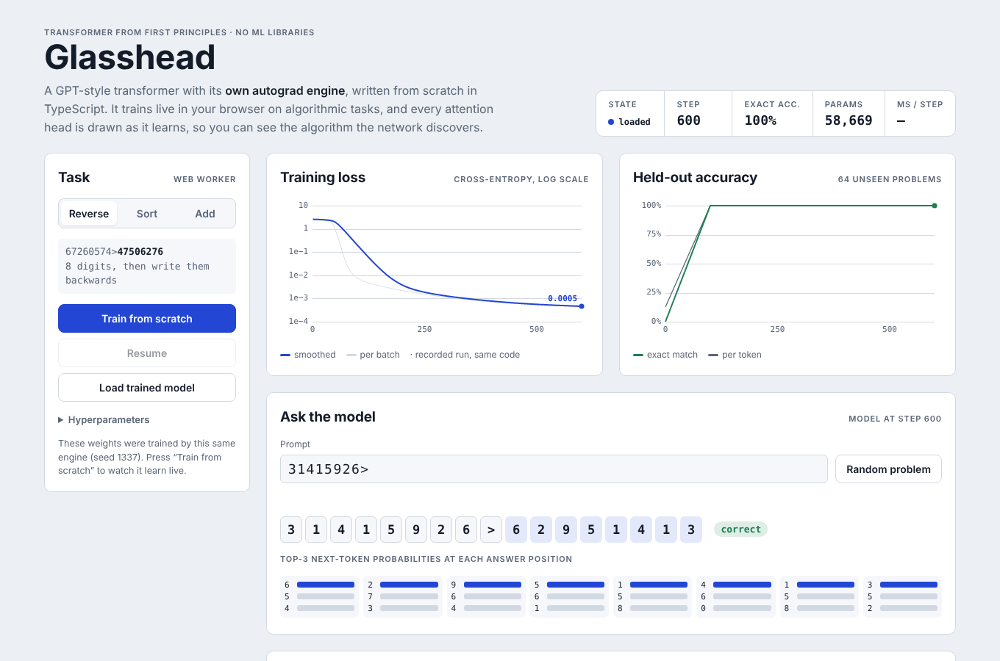

# Glasshead

A small transformer language model built from first principles in TypeScript — **its own reverse-mode autograd engine, no ML libraries** — that trains live in the browser and draws every attention head as it learns.

The model is trained on small algorithmic tasks (reverse, sort, add) where the *correct algorithm is known*, so you can open the attention maps and check whether the network actually discovered it.

**Live demo: https://wichayut-dev.github.io/glasshead/** (runs entirely in your browser, Thai / English)



## Why this project

Most portfolio ML projects call `model.fit()`. This one implements the thing underneath:

| Layer | What is implemented here |
|---|---|
| Autograd | `Tensor` with a recorded graph, iterative topological sort, gradient accumulation |
| Ops | matmul, bias broadcast, embedding (scatter-add backward), LayerNorm, GELU, masked cross-entropy |
| Attention | multi-head **causal self-attention as one fused op with a hand-derived backward pass** |
| Model | decoder-only transformer: pre-LN blocks, learned positional embeddings, residual-scaled init |
| Training | AdamW (decoupled weight decay), global-norm gradient clipping, warmup + cosine LR, seeded RNG |
| Proof | finite-difference gradient checks for every op **and for the full model end-to-end** |
| App | training runs in a Web Worker; live loss/accuracy curves, attention heatmaps, top-k probabilities, Thai / English UI |

Everything is reproducible: the same seed gives the same initial weights, the same batches and the same loss curve.

## Results (seed 1337, 2 layers × 4 heads, d_model 48, ~59k parameters)

| Task | Example | Peak LR | Steps trained | ≥95% exact-match by step | Held-out exact-match (1,000 problems) |
|---|---|---|---|---|---|
| Reverse | `31415926>` → `62951413` | 3e-3 | 600 | 100 | **100%** |
| Sort | `73019482>` → `01234789` | 3e-3 | 1,500 | 500 | **100%** |
| Add | `479+386=` → `5680` (865, ones digit first) | 1e-2 | 3,000 | 2,000 | **99.5%** (99.85% per digit) |

Exact-match is measured on problems the model never trained on, generated from a separate RNG stream.

### What the attention maps show

- **Reverse** — an anti-diagonal: output position *k* attends to input position *8 − k*. The network learned to compute a pointer from its own position.
- **Sort** — each output token attends to the input digit that comes next in sorted order: attention as a content-addressed lookup.
- **Add** — output digits attend to the matching column of both operands, plus the previous column to resolve the carry.

## Correctness: gradient checks

Every backward pass is verified against central finite differences, `(L(x+ε) − L(x−ε)) / 2ε`, using Float64 tensors so the comparison is meaningful:

```
matmul                          8.8e-11
add (residual)                  3.1e-10
bias broadcast                  3.4e-10
embedding (scatter-add)         3.6e-11
layernorm                       2.1e-9
gelu                            2.2e-9
causal self-attention (fused)   1.0e-9
cross-entropy (masked)          1.8e-8
full model forward → loss       2.0e-8
```

The same check runs in the browser from the **Prove the gradients** panel.

### Fused attention backward

For each batch item and head, with `S = QKᵀ/√d` (causally masked), `P = softmax(S)`, `O = PV`:

```
dV = Pᵀ dO
dP = dO Vᵀ
dS = P ⊙ (dP − rowsum(P ⊙ dP))
dQ = dS K / √d
dK = dSᵀ Q / √d
```

## Run it

Requires Node.js ≥ 22.18 (runs TypeScript directly, no transpile step for tests or training).

```bash
npm install
npm test                                  # gradient checks + reproducibility + learning tests
node scripts/train.ts reverse 600         # train headless and print accuracy
node scripts/train.ts sort 1500 --save    # also save weights for the web demo
npm run build                             # -> dist/index.html (single self-contained file)
```

Open `dist/index.html` in a browser, or host it on GitHub Pages / Netlify as a static file.

## Project layout

```
src/engine/
  tensor.ts     Tensor + reverse-mode autodiff
  ops.ts        differentiable ops, including fused causal attention
  model.ts      transformer model
  optim.ts      AdamW + LR schedule
  tasks.ts      reverse / sort / add datasets and ground-truth solvers
  trainer.ts    training loop, greedy decoding, evaluation, probe for the UI
  gradcheck.ts  finite-difference gradient checking
  rng.ts        seeded PRNG
src/app/
  host.ts       training loop host (Web Worker, with a main-thread fallback)
  worker.ts     worker entry
  main.ts       UI: charts, attention heatmaps, probe, gradient-check panel
  index.html    page template and styles
scripts/        headless training, single-file build
tests/          gradient checks, reproducibility and learning tests (node:test)
```

## Ideas for extending it

- KV-cache for faster generation
- Float32 + WebGPU compute shaders for the matmuls
- Activation patching: zero out one head and measure which tasks break
- Longer sequences and character-level text (e.g. a small Thai corpus)

---

## ภาษาไทย (สรุป)

**Glasshead** คือโมเดล Transformer ที่เขียนขึ้นเองทั้งหมดด้วย TypeScript โดยไม่ใช้ไลบรารี ML ใด ๆ รวมถึงระบบ autograd (การคำนวณ gradient อัตโนมัติ) ที่เป็นแกนหลักของ PyTorch ก็เขียนเอง

- เทรนโมเดลได้สดในเบราว์เซอร์ และแสดง attention ทุก layer/head แบบ real-time
- ใช้งานที่รู้คำตอบที่ถูกต้อง (กลับลำดับตัวเลข, เรียงลำดับ, บวกเลข) เพื่อพิสูจน์ได้ว่าโมเดลค้นพบ "อัลกอริทึม" อะไร
- ทุก backward pass ตรวจสอบด้วย finite difference (gradient check) ได้ error ระดับ 1e-9 รวมถึงทั้งโมเดลแบบ end-to-end
- attention เป็น fused op ที่ derive สูตร gradient ด้วยมือ

License: MIT
